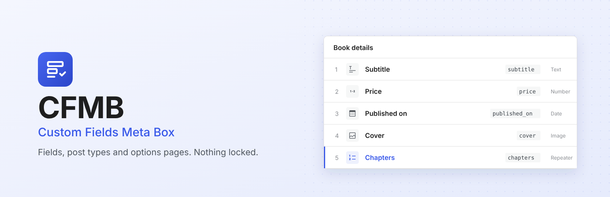
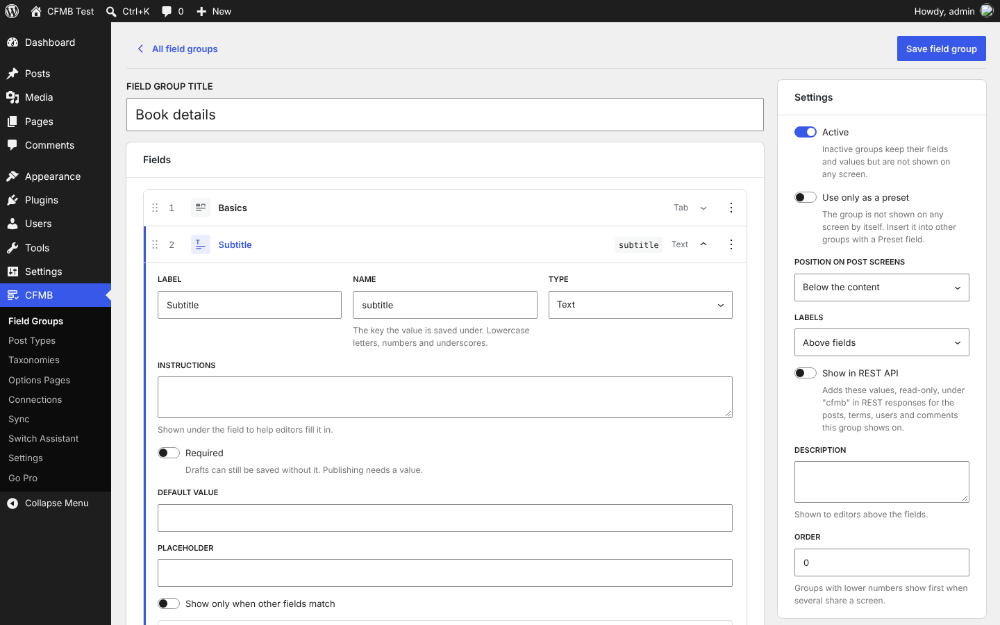
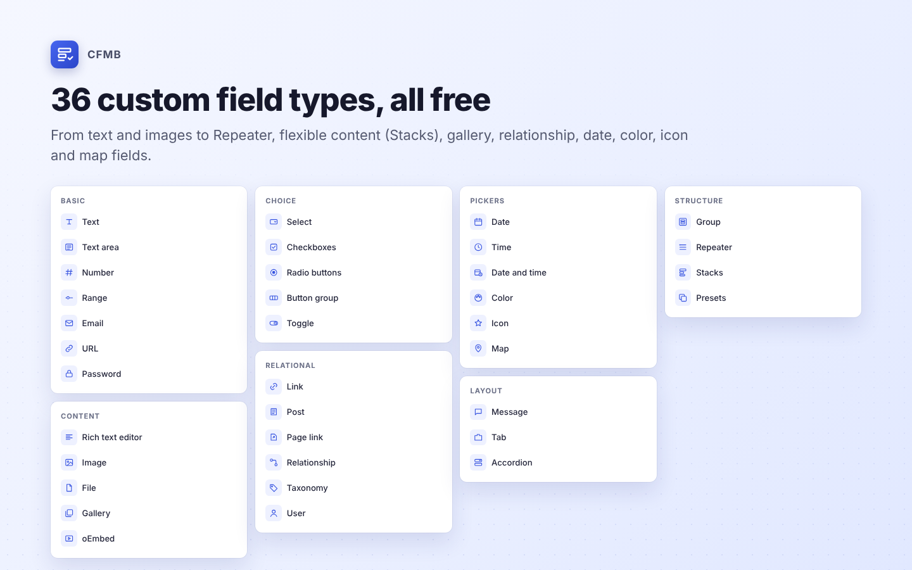
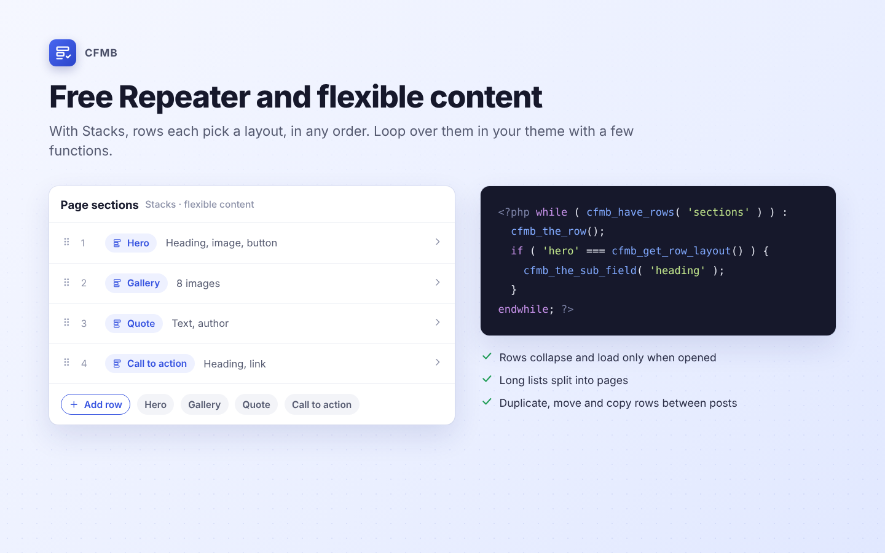
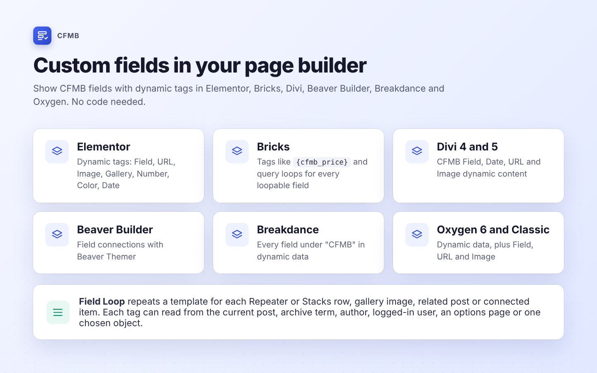

<p align="center">
  
</p>

# CFMB - Custom Fields Meta Box

**A free WordPress custom fields plugin.** Add meta boxes with custom fields, repeater fields, flexible content, galleries, custom post types, custom taxonomies and options pages, then show the values in your theme, in Gutenberg blocks and in page builders. Nothing is locked.

[](https://www.gnu.org/licenses/gpl-2.0.html)


**[Download on WordPress.org](https://wordpress.org/plugins/custom-fields-meta-box/)** · **[Website](https://mozi2wp.com/cfmb)** · **[CFMB Pro](https://mozi2wp.com/cfmb-pro)**

## Why CFMB

- **Free ACF Pro features.** Repeater, flexible content (Stacks), gallery, clone (Presets), options pages and custom blocks are free.
- **Content modeling in one plugin.** Custom fields, meta boxes, custom post types, custom taxonomies, options pages and two-way relationships.
- **Clean, queryable post meta.** Values are saved under the field name, so `get_post_meta()`, `WP_Query` and `meta_query` work.
- **Migrate from ACF or Secure Custom Fields** with the Switch Assistant, with undo.
- **Works with** Gutenberg, Block Bindings, Elementor, Bricks, Divi, Beaver Builder, Breakdance, Oxygen, WooCommerce, WPML, Polylang, Yoast SEO, Rank Math, the REST API and WPGraphQL.
- **Developer friendly.** JSON Schema Sync for Git, `cfmb_register_group()` in PHP, WP-CLI commands and documented hooks.

## Screenshots

| | |
| --- | --- |
|  |  |
|  |  |

## Field types

| Group | Fields |
| --- | --- |
| Basic | Text, Text area, Number, Range, Email, URL, Password |
| Content | WYSIWYG editor, Image, File, Gallery, oEmbed |
| Choice | Select, Checkbox, Radio, Button group, Toggle |
| Relational | Link, Post object, Page link, Relationship, Taxonomy, User |
| Pickers | Date, Time, Date and time, Color, Icon, Map (Google Maps or OpenStreetMap) |
| Layout | Message, Tab, Accordion |
| Structure | Group, Repeater, Stacks (flexible content), Presets (clone) |

## Where meta boxes can show

Post types, page templates, post status, post format, terms, taxonomies, user roles, user forms, options pages, comments, attachments, menus, menu items, widgets, blocks, and WooCommerce product types and variations. Combine rules with "and" and "or", and use conditional logic to show fields based on other fields.

## Quick start

1. Install and activate the plugin.
2. Go to **CFMB > Field Groups** and click **Add field group**.
3. Add fields, choose where the meta box shows under **Location**, and save.
4. Show a value in your theme:

```php
<?php cfmb_the_field( 'subtitle' ); ?>
```

Loop over a Repeater or flexible content (Stacks) field:

```php
<?php while ( cfmb_have_rows( 'sections' ) ) : cfmb_the_row(); ?>
	<?php if ( 'hero' === cfmb_get_row_layout() ) : ?>
		<h2><?php cfmb_the_sub_field( 'heading' ); ?></h2>
	<?php endif; ?>
<?php endwhile; ?>
```

Read values from terms, users, comments, widgets and options pages:

```php
cfmb_get_field( 'color', 'term_12' );
cfmb_get_field( 'twitter', 'user_3' );
cfmb_get_field( 'phone', 'option' );
```

To register field groups in code, export them as PHP from **CFMB > Sync** and load them with `cfmb_register_group()`.

## Custom Gutenberg blocks with fields

Turn on **Use as a Field Block** in a field group, name the block (for example `hero`) and add `cfmb-blocks/hero.php` to your theme:

```php
<section <?php echo cfmb_block_wrapper_attributes(); ?>>
	<h2><?php cfmb_the_field( 'heading' ); ?></h2>
	<InnerBlocks />
</section>
```

## WP-CLI

```bash
wp cfmb sync      # compare and apply JSON Schema Sync files
wp cfmb export    # export field groups
wp cfmb import    # import field groups
wp cfmb doctor    # check the setup
wp cfmb switch run  # migrate from ACF or Secure Custom Fields
```

## Migrating from ACF

Run **CFMB > Switch Assistant** to import field groups, post types, taxonomies, options pages and values from ACF or Secure Custom Fields. If your theme calls `get_field()` and `have_rows()`, install [CFMB Compatibility Mode](https://github.com/mozi2wp/cfmb-compatibility-mode) so they keep working while you update templates.

## Development

```bash
composer install
npm install
npm run build
```

- JavaScript and SCSS source: `assets/src`. Compiled files: `build`.
- Tests: PHPUnit, Jest, PHPCS (WordPress Coding Standards) and PHPStan.

## Contributing

Bug reports and pull requests are welcome in [Issues](https://github.com/mozi2wp/cfmb/issues). For support, use the [WordPress.org support forum](https://wordpress.org/support/plugin/custom-fields-meta-box/).

## License

GPLv2 or later. Made by [Mozi2WP](https://mozi2wp.com).
